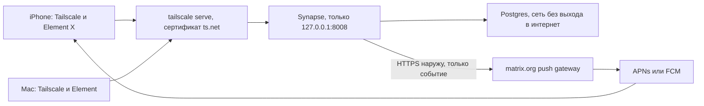

# Свои

Закрытый чат для своих на [Matrix](https://matrix.org/). Друзья ставят Tailscale и пишут в Element. Сервер не слушает публичный интернет и не зависит от Telegram или Discord.

Телефоны: Element X из App Store и, реже, из Play Store. Mac: Element Web с этого же сервера или Element Desktop. Домашний сервер: Synapse и Postgres.

## Что получается в первый день

- Учётные записи создаёт только хозяин сервера. Открытой регистрации нет.
- Комнаты шифруются по умолчанию.
- Федерация выключена: чужие homeserver сюда не ходят, и этот сервер к ним не ходит.
- iPhone получает баннер, когда Tailscale на телефоне включён всегда. Текст сообщения на шлюз Element не уходит.
- Бэкап базы, ключа подписи и медиа. Почасовой таймер.
- Проверка `make smoke`: здоровье сервера, закрытая регистрация, порт только на `127.0.0.1`.

## Честные границы

Один узел. Это не кластер. Месячная цель по API клиентов: 99.5%. Время доставки пуша в цель не входит: его держат Apple, Google и VPN на телефоне.

Tailscale Personal на момент проверки в октябре 2026 включает 6 пользователей. Седьмому человеку нужен платный план или Headscale. Цифру сверяйте на [tailscale.com/pricing](https://tailscale.com/pricing).

Сервер видит метаданные переписки. Тела зашифрованных сообщений он не читает. Подробности в [модели угроз](docs/security/threat-model.md).

Голосовые сообщения работают сразу. Групповые звонки включаются отдельно и требуют проверки между двумя телефонами.

## Как это соединено



У чата нет публичного порта. Tailscale ходит наружу сам и через DERP. Synapse ходит наружу только чтобы отдать пуш. Файрвол VPS и остальные сервисы на нём этот репозиторий не меняет.

## Что нужно

- Хост, который не засыпает: ваш VPS с Docker и Tailscale, либо Mac mini. Ноутбук, который спит, роняет чат. Другие сервисы на этом VPS не трогаем.
- Аккаунт Tailscale. Узел чата с тегом `tag:messenger`.

Имя сервера (`MATRIX_SERVER_NAME`) равно MagicDNS-имени этой машины, например `messenger.example.com`. Оно навсегда становится суффиксом `@alice:это-имя`. Смена имени — это новый сервер.

## Поднять

```bash
cp .env.example .env
# впишите MagicDNS-имя: tailscale status
make init
make render
make up
make serve
make smoke
make admin USER=operator
make user USER=alice
```

Дальше: [инструкция хозяина](docs/guides/operator.md), [iPhone](docs/guides/iphone.md), [Mac](docs/guides/mac.md), [Android](docs/guides/android.md).

ACL для консоли Tailscale лежит в [`deploy/tailscale/acl.hujson`](deploy/tailscale/acl.hujson). Это пример доступов к узлу чата. Если в tailnet есть другие машины, допишите grant в свою политику, не заменяйте её целиком. Друзья открывают только чат. SSH и Grafana этого узла остаются админу.

Чат не меняет файрвол VPS. Synapse и Element слушают localhost, дверь наружу — `tailscale serve`.

## Каждый день

| Команда | Зачем |
| --- | --- |
| `make ps` | контейнеры |
| `make logs` | логи Synapse |
| `make backup` | снимок базы, ключа подписи и медиа в `backups/` |
| `make drill` | поднять дамп во временном Postgres и посчитать `users` |
| `make user USER=bob` | учётка |
| `make observe` | Prometheus, Loki, Grafana на `:3443` |
| `make down` | остановить, тома не удаляются |

Таймер `deploy/systemd/svoi-backup.timer` запускает бэкап раз в час. Каталог `backups/` копируйте вместе с остальными бэкапами этого сервера.

Обновление образов, восстановление, пропавшие пуши и потерянный телефон: каталог [`docs/runbooks`](docs/runbooks).

## Спецификация

Полные требования, критерии приёмки и отказы от альтернатив:

- [Спецификация](docs/spec/SPEC.md)
- [ADR](docs/adr)
- [SLO](docs/sre/slo.md)
- [Наблюдаемость](docs/sre/observability.md)
- [Бэкапы](docs/sre/backup.md)
- [Модель угроз](docs/security/threat-model.md)
- [Звонки](docs/guides/calls.md)
- [Headscale](docs/guides/headscale.md)

## Поставка

CI гоняет shellcheck, yamllint, генерацию конфига, `docker compose config` и gitleaks. Он ничего не выкладывает на сервер.

Теги образов записаны в `.env.example`. Synapse `v1.163.0`, Element Web `v1.12.32`, Postgres 17. `make pin` печатает digest после pull. Renovate открывает PR на теги, выкатка остаётся ручной: бэкап, смена тега, `make up`, `make smoke`.

Секреты генерируются в `secrets/` и не коммитятся. Сгенерированный `homeserver.yaml` тоже не коммитится: в нём пароль базы и macaroon.

## Лицензия

Код и документы этого репозитория: Apache-2.0. Образы Synapse, Element, Postgres, LiveKit и Grafana остаются под своими лицензиями.
